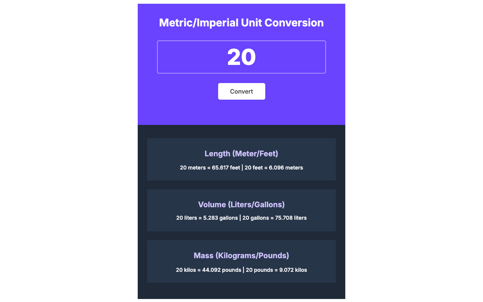

# Unit Converter 📏

Type one number and see it converted between metric and imperial units at once.

**Live demo:** https://mccprogrammer.github.io/unit-converter/



## Features

- Length: meters ↔ feet
- Volume: liters ↔ gallons
- Mass: kilograms ↔ pounds
- Both directions shown for every unit

## Run it locally

No build step: clone the repo and open `index.html` in a browser.

```bash
git clone https://github.com/MCCProgrammer/unit-converter.git
open unit-converter/index.html
```

## Built with

HTML, CSS and plain JavaScript.

---

One of my first web projects. More of my work at [mccprogrammer.com/projects](https://mccprogrammer.com/projects).
